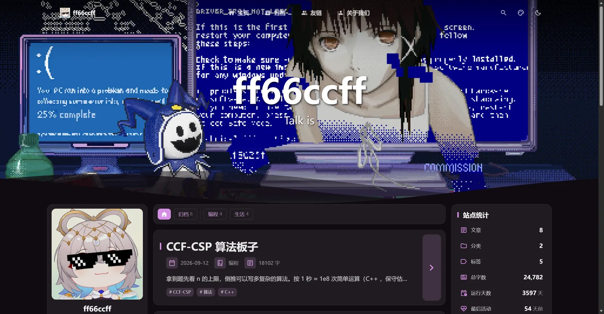
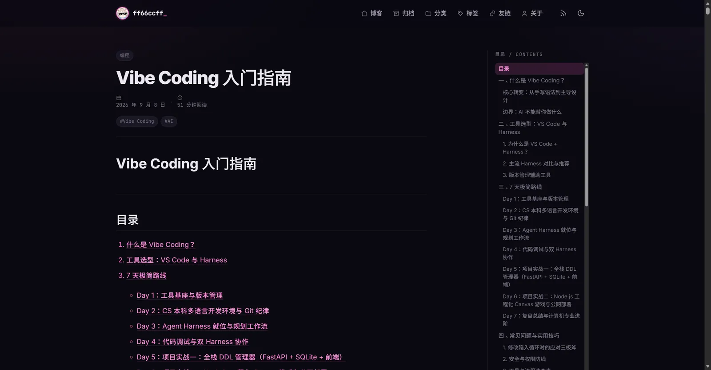

# ff66ccff.github.io

ff66ccff 的个人主页：技术手记、生活随想、中文 VOCALOID 与科幻。

线上地址：<https://ff66ccff.github.io>

2026 年从 **Hexo 7 + Volantis** 迁移到 **Astro 7 + [Mizuki](https://github.com/LyraVoid/Mizuki) 主题**：文章、个人资料、友链与一言数据全部保留，文章链接保持旧的 `/年/月/日/文件名/` 格式。

> 本项目基于开源主题 Mizuki（Apache-2.0）构建，只改了配置、内容、数据与少量主题适配，没有重写主题组件。

| 首页 | 文章页 |
| --- | --- |
|  |  |

| 友链 | 移动端 |
| --- | --- |
|  |  |

## 技术栈

| 能力 | 实现 |
| --- | --- |
| 框架 | Astro 7.1.3（静态输出） |
| 主题 | Mizuki（Apache-2.0；Tailwind CSS 4、Svelte 5、Swup 页面过渡） |
| 代码高亮 | Expressive Code |
| 一言打字机 | 主题内置 `TypewriterText` 组件 + 本仓库的 710 句一言列表 |
| 评论 | giscus（沿用旧站同一仓库与 pathname 映射） |
| 搜索 | Pagefind（构建时生成索引） |
| 订阅 | Atom（/atom.xml）、RSS（/rss.xml）、兼容旧 /rss2.xml |
| 其他 | KaTeX、Mermaid、Fancybox 灯箱、目录、暗色模式、i18n（zh_CN） |
| 部署 | GitHub Actions + GitHub Pages |

## 本地开发

需要 Node.js >= 22.12 与 pnpm 11。

```bash
corepack enable        # 启用 package.json 里声明的 pnpm 版本
pnpm install
pnpm dev               # http://localhost:3000
pnpm build             # 构建 dist/ 并生成 Pagefind 搜索索引
pnpm preview           # 预览生产构建
pnpm check             # astro check
```

> 本地构建不需要外部内容仓库：根目录 `.env` 中 `ENABLE_CONTENT_SYNC=false` 即可（该文件不入库）。

## 目录结构

```text
src/
├─ config/              # 站点配置（Mizuki 的配置体系）
│  ├─ siteConfig.ts     # 站点标题、语言、主题色、横幅与一言、特色页面开关
│  ├─ profileConfig.ts  # 个人资料：头像、昵称、简介、社交链接
│  ├─ navBarConfig.ts   # 导航栏
│  ├─ commentConfig.ts  # giscus 配置
│  ├─ footerConfig.ts   # 页脚
│  ├─ permalinkConfig.ts# 旧站永久链接格式
│  └─ sidebarConfig.ts  # 侧边栏组件布局
├─ content/
│  ├─ posts/            # 8 篇文章
│  └─ spec/             # 关于 / 友链页面的 Markdown
├─ data/
│  ├─ friends.ts        # 友链数据
│  └─ quotes.ts         # 710 句一言
├─ pages/               # 路由（主题提供）
└─ components/          # 主题组件
public/                 # 头像、照片、favicon、旧站 URL 跳转页
docs/                   # 主题文档 + 迁移说明
research/               # 迁移前的调研与验证记录（历史资料）
```

## 内容维护

### 新增文章

在 `src/content/posts/` 新建 Markdown 文件：

```yaml
---
title: "文章标题"
published: 2026-11-06T12:00:00+08:00
updated: 2026-11-06T12:00:00+08:00   # 可选
tags: ["Astro", "前端"]
category: "编程"
draft: false
---
```

文章 URL 由 `src/config/permalinkConfig.ts` 控制，当前为 `%year%/%monthnum%/%day%/%raw_postname%`，与 Hexo 旧链接一致（保留文件名大小写）。标题由主题从 frontmatter 渲染，正文不需要再写一级标题。

### 修改个人资料 / 友链 / 一言

- 个人资料：`src/config/profileConfig.ts`
- 友链：`src/data/friends.ts`（友链页介绍文字在 `src/content/spec/friends.md`）
- 一言：`src/data/quotes.ts`（首页横幅的打字机按顺序轮播）
- 站点标题、主题色、横幅图、特色页面开关：`src/config/siteConfig.ts`

## 部署

推送到 `main` 后，`.github/workflows/deploy.yml` 使用 `withastro/action@v6`（Node 24 + pnpm 11）构建并部署到 GitHub Pages。仓库是用户主页根仓库，因此 `base` 保持 `/`。

## 旧站兼容

- 文章：`/2025/11/09/welcome-to-the-blog/` 等 8 个旧链接全部保留。
- `/archives/`、`/tags/*`、`/categories/*`：静态跳转页，自动跳到主题的 `/archive/` 并带上对应筛选参数。
- `/atom.xml`、`/rss.xml`、`/rss2.xml`：均可用。
- 评论区沿用 giscus 的 `pathname` 映射，旧文章链接下的历史评论继续可见。

详细迁移记录见 [docs/migration-from-hexo.md](docs/migration-from-hexo.md)。

## 许可

- 站点内容：<a rel="license" href="https://creativecommons.org/licenses/by-nc-sa/4.0/deed.zh-hans">CC BY-NC-SA 4.0</a>
- 主题：[Mizuki](https://github.com/LyraVoid/Mizuki)，Apache-2.0（仓库内保留 `LICENSE`、`LICENSE.MIT`、`THIRD_PARTY_NOTICES.md`）
