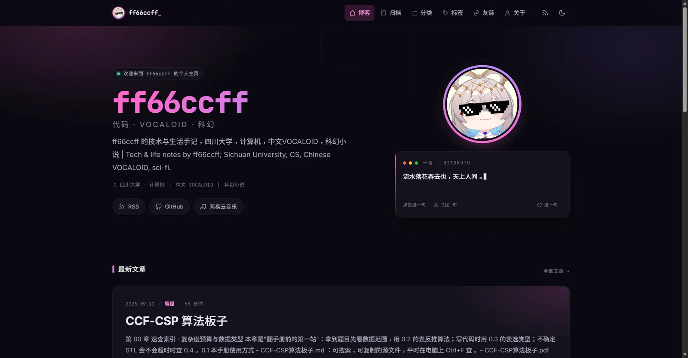
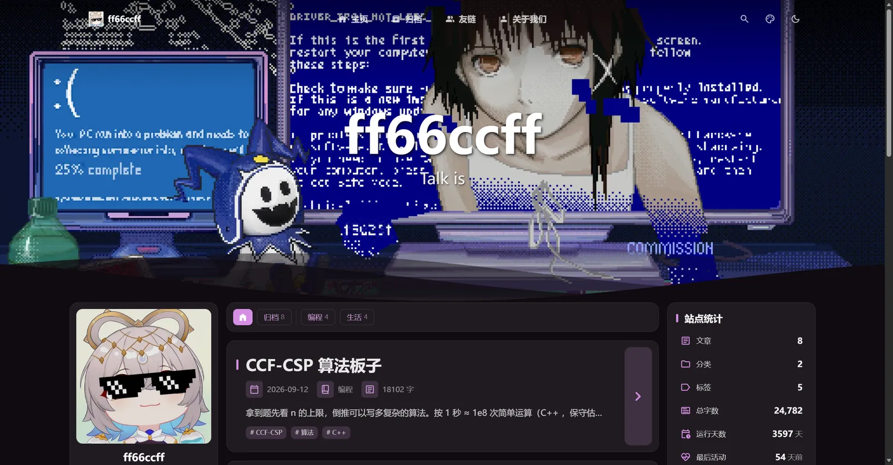
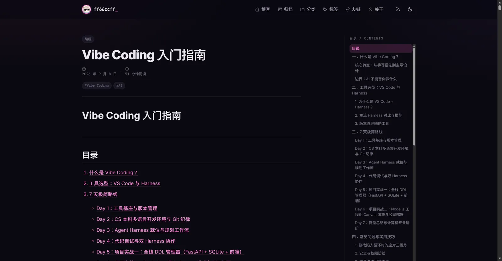
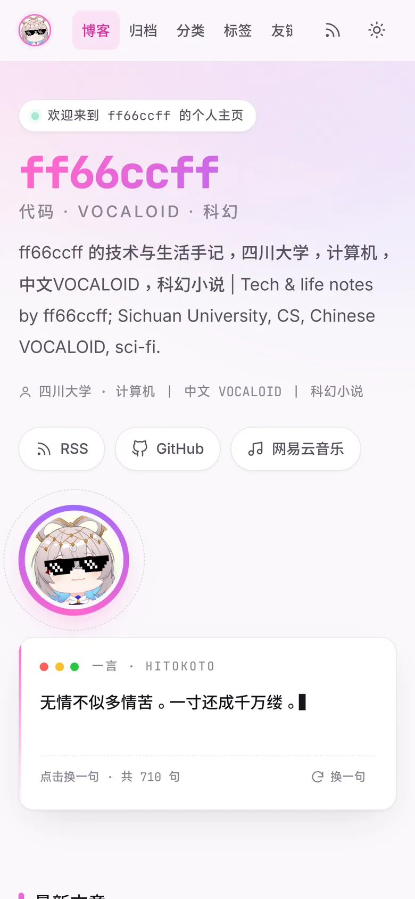
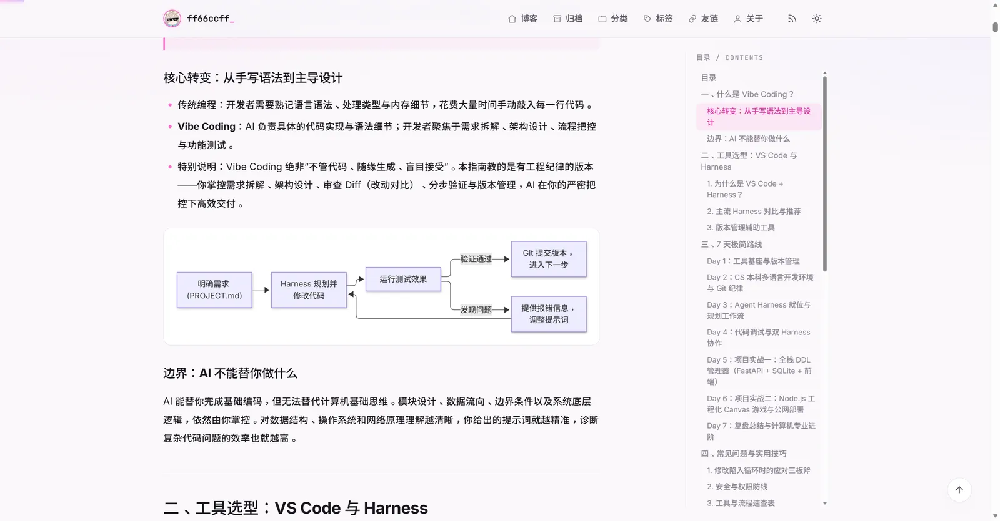
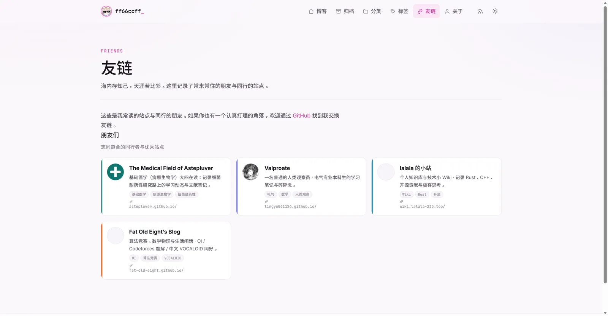

# 从 Hexo 迁移到 Astro：记录与决策

> 迁移日期：2026-11-06
> 旧站：Hexo 7.3 + Volantis 主题（`eb2f92e`）
> 新站：Astro 7.4.7 + 自建设计系统

## 1. 结果总览

| 内容 | 状态 |
| --- | --- |
| 文章 | 8 篇，正文逐字节与 Hexo 原文件一致（8/8 校验通过） |
| 个人资料 | 昵称、头像、描述、社交链接（RSS / GitHub / 网易云音乐）保持不变 |
| 友链 | 1 个分组、4 个站点，字段与 `friends.yml` 完全一致 |
| 一言 | 710 句，从 `sentences.md` 转为 `src/data/quotes.json` |
| 评论 | 沿用原 giscus 配置（repo / category / mapping 不变） |
| 图片 | `avatar.jpg` 与 `photos/` 原样复制到 `public/` |

## 2. URL 兼容

迁移动机之一是「保持旧链接不断」，因此永久链接与 Hexo 完全一致：

| 页面 | URL |
| --- | --- |
| 首页 | `/` |
| 文章 | `/2025/11/09/welcome-to-the-blog/`、`/2026/09/12/CCF-CSP算法板子/`（保留文件名大小写） |
| 归档 | `/archives/` |
| 分类 | `/categories/`、`/categories/编程/` |
| 标签 | `/tags/`、`/tags/C/`（C++ 的标签 slug 与 Hexo 一致）、`/tags/Vibe-Coding/` |
| 友链 | `/friends/` |
| 订阅 | `/atom.xml`（Atom 2.0）、`/rss.xml`、`/rss2.xml`（旧路径别名） |
| 站点地图 | `/sitemap-index.xml`、`/robots.txt` |

实现要点：

1. Content Collections 使用 `glob` loader 的 `generateId`，保留原始文件名大小写（默认实现会转小写，导致 `CCF-CSP算法板子` 变成 `ccf-csp算法板子`）。
2. 文章路由 `src/pages/[year]/[month]/[day]/[slug].astro` 的 `params` 直接使用 `post.id`，并对日期统一按 `Asia/Shanghai` 取年月日，避免 CI（UTC）时区导致 URL 偏移一天。
3. 分类 / 标签 slug 使用与 Hexo 一致的规则：空白转 `-`、去除符号（`C++` → `C`，`Vibe Coding` → `Vibe-Coding`）。

## 3. 关键实现

### 3.1 内容层

- `src/content.config.ts`：Astro 5 起的 Content Layer API，`glob` loader + Zod schema（`astro/zod`）。
- Astro 7 默认 Markdown 处理器是 Rust 版 Sätteri；为了使用 remark 插件（GFM）与统一的自定义处理，显式选择 `@astrojs/markdown-remark` 的 `unified()` 处理器。
- 自定义 remark 插件 `src/lib/remark-remove-leading-h1.mjs`：渲染阶段去掉正文开头重复的一级标题（页面已用 `h1` 展示标题，Markdown 源文件保持原样）。
- 文章正文的 Shiki 双主题通过 `shikiConfig.defaultColor: false` + CSS 变量实现，跟随站点亮暗主题切换。

### 3.2 RSS / Atom

Astro API 端点里无法直接渲染 `render(entry)` 返回的组件，因此按官方推荐做法：用 `markdown-it` 解析 `post.body`、`sanitize-html` 过滤，再把站内相对链接转成绝对地址，作为 Atom `<content>`（RSS 为 `content:encoded`）。

### 3.3 视图过渡

使用 `<ClientRouter />`（Astro 7 已移除 `<ViewTransitions />`）。所有页面级脚本（代码复制、目录高亮、giscus、mermaid、阅读进度）统一监听 `astro:page-load`，并用 `data-*` 标记做幂等处理；giscus 在 `astro:before-swap` 清空容器，避免 SPA 跳转后评论残留。

### 3.4 giscus / mermaid / 灯箱

- giscus：沿用原配置，主题随站点亮暗切换重新挂载。
- mermaid：`syntaxHighlight.excludeLangs` 排除 `mermaid`，客户端按需动态加载 mermaid（只有含图表的文章会加载），切换主题时重绘。
- 灯箱：原生 `<dialog>`，无第三方依赖。

## 4. 一言打字机：调研结论

旧实现（`source/_volantis/bodyEnd.ejs` + `source/hitokoto/sentences.md`）的问题：

- 首屏是「加载中...」，必须等 fetch 37 KB Markdown、正则解析 714 行后才开始打字（作者自己称为「Loading... 之痛」）；
- `setInterval` 固定 55 ms，每字重写整个文本节点，无 `prefers-reduced-motion`、无键盘操作、无 `aria-live`；
- 无清理路径，SPA 页面切换可能留下定时器。

候选方案对比（完整数据与来源见 [research/typewriter-and-astro.md](../research/typewriter-and-astro.md)）：

| 方案 | gzip | 结论 |
| --- | --- | --- |
| 自研 CSS 逐字 reveal（静态整句 + `animation-delay`） | 0.7 KiB | 最轻，但不是「成熟库」 |
| **typewriter-effect 3.3.0** | 5.9 KiB | **采用**：MIT，2026-10 仍在维护，支持 `initialText` / 字素切分 / 光标 |
| TypeIt 8.8.7 | 4.5 KiB | 备选，但 GPL-3.0 且 2025 年后无提交 |
| Typed.js 3.0.0 | 3.2 KiB | 不采用：3.0 起改 GPL-3.0，且按 UTF-16 切字会拆坏 emoji |
| GSAP / anime.js / Motion | 31–58 KiB | 能力过剩，无打字原语 |

最终实现（`src/components/Hitokoto.astro` + `src/scripts/hitokoto.ts`）：

1. **构建期静态渲染完整一句**：无 JS、SEO、RSS 都能读到；容器预留 `min-height`，CLS 为 0。
2. 点击「换一句」才 `import()` 全部 710 句（约 19 KiB gzip，独立 chunk），用 typewriter-effect 重新打字。
3. `prefers-reduced-motion` 或标签页不可见时直接落字，不做动画。
4. 键盘可操作，`aria-live` 播报完整句子；`astro:page-load` 时幂等重新挂载。

## 5. 视觉与工程升级

| 首页（亮色） | 首页（暗色） |
| --- | --- |
|  |  |

| 文章页（暗色） | 移动端 |
| --- | --- |
|  |  |

| Mermaid 图表 | 友链 |
| --- | --- |
|  |  |

完整截图（含 404、关于、浅色代码块、暗色 Mermaid）在 [`docs/screenshots/`](screenshots/) 下。

- 以 `#FF66CC` 为强调色的亮 / 暗双主题设计系统（`src/styles/global.css`），替代了原主题的终端风叠加样式。
- 阅读进度条、回顶、目录滚动高亮、代码块复制、图片灯箱、mermaid、404 页、控制台彩蛋。
- Open Graph / Twitter Card / JSON-LD / sitemap / robots / 默认 OG 图（`public/og-default.jpg`）。
- 字体自托管（Inter Variable、JetBrains Mono Variable），中文走系统字体栈，避免大体积中文字库。
- 构建产物体积、Lighthouse 友好的静态页面；无客户端框架运行时。

## 6. 已知取舍

- **超大文章页**：`CCF-CSP 算法板子` 的构建产物约 1.9 MB（136 个代码块全部由 Shiki 以双主题 token 输出）。这是「完整保留原文 + 服务端高亮」的代价，换来零运行时高亮与源码可复制；如后续需要，可改用客户端按需高亮或拆分长文。
- **mermaid 体积**：mermaid 仅在含图表的文章按需加载，但它的部分图形引擎 chunk 较大（懒加载，不进首屏关键路径）。
- **旧封面图**：`public/photos/wallhaven-yq5ejd_3840x2400.png` 从旧站保留，当前用于生成 `public/og-default.jpg`；页面本身已改用渐变背景。
- **构建期一言**：首屏那句一言按「距 2026-01-01 的天数」取模选择，同一自然日构建结果一致，每天自动换一句。
- **图片压缩工作流**：压缩提交由 bot 用自己的 token 推送，不会触发 Pages 部署，因此 workflow 末尾显式 `gh workflow run deploy.yml`。

## 7. 后续可做

- 站内搜索（Pagefind 或 Pagefind + Astro 集成）。
- 每篇文章自动生成 OG 图。
- 文章草稿（`draft: true`）与更细的 series 支持。
- 图片迁移到 `astro:assets` 做构建期压缩（历史图片路径保持不变，暂未迁移）。

## 8. 回滚

旧站文件已从工作区删除，但 git 历史完整保留：迁移前最后一次提交是 `eb2f92e`（`git show eb2f92e:_config.yml` 等可按需取回）。如需完全回滚，`git revert` 本次迁移提交即可。
